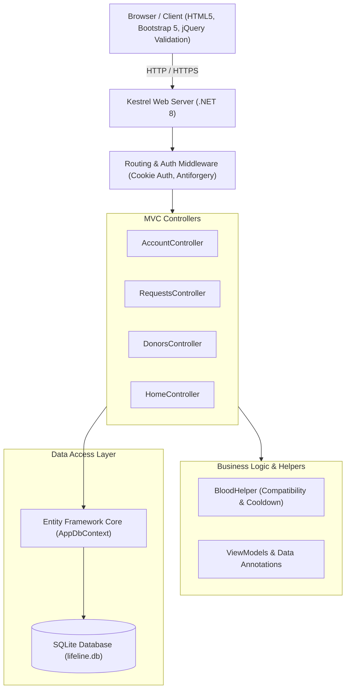
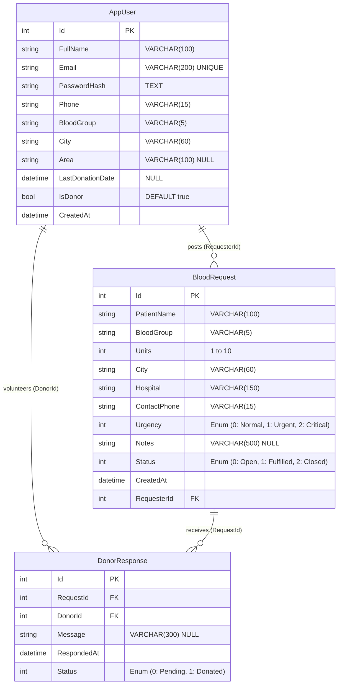

# LifeLine – Project Defense & Viva Guide

A comprehensive guide covering the architecture, workflows, validation rules, database design, and anticipated faculty questions for the **LifeLine** Hyperlocal Blood Donor Network mini-project.

---

## 1. Project Overview & Real-World Use Case

### Problem Statement
In medical emergencies (accidents, surgeries, dengue/platelet depletion), finding compatible blood donors quickly is challenging. Conventional blood banks often have stockouts, and social media requests lack verification, donor eligibility checks, and location filtering.

### Solution: LifeLine
**LifeLine** is a hyperlocal blood donation web application built with **ASP.NET Core 8 MVC** and **Entity Framework Core (SQLite)**. It connects verified blood donors with people in urgent need based on:
1. **Hyperlocal proximity:** Search by city and neighborhood/area.
2. **Biological compatibility:** Automatic mapping of recipient blood groups to eligible donor blood groups (e.g., $O^-$ universal donor, $AB^+$ universal recipient).
3. **Medical cooldown compliance:** Automatic enforcement of the standard 90-day cooldown period between donations to safeguard donor health.

---

## 2. System Architecture & Tech Stack



| Layer | Technology | Purpose |
|---|---|---|
| **Framework** | ASP.NET Core 8.0 (MVC) | Controller-action pattern, dependency injection, middleware pipeline |
| **Language** | C# 12 | Pattern matching, records, global usings, nullable reference types |
| **ORM** | Entity Framework Core 8 | Object-Relational Mapping, LINQ queries, code-first model mapping |
| **Database** | SQLite (`lifeline.db`) | Lightweight, zero-configuration embedded relational SQL database |
| **Authentication** | Cookie Authentication | Encrypted HTTP-only auth cookies with sliding expiration |
| **Frontend UI** | Bootstrap 5.3 + Bootstrap Icons | Responsive mobile-first CSS framework and vector icons |
| **Client Validation** | jQuery 3.7 + jQuery Validate + Unobtrusive | Instant browser-side input validation without page reload |

---

## 3. Core Business Logic & Algorithms

### 3.1 Blood Compatibility Matrix (`BloodHelper.cs`)
Blood group compatibility is governed by red blood cell antigens ($A, B, Rh$). `BloodHelper.cs` maps recipient groups to medically compatible donor groups:

$$\begin{aligned}
A^+ &\leftarrow \{A^+, A^-, O^+, O^-\} \\
A^- &\leftarrow \{A^-, O^-\} \\
B^+ &\leftarrow \{B^+, B^-, O^+, O^-\} \\
B^- &\leftarrow \{B^-, O^-\} \\
AB^+ &\leftarrow \{A^+, A^-, B^+, B^-, AB^+, AB^-, O^+, O^-\} \quad \text{(Universal Recipient)} \\
AB^- &\leftarrow \{A^-, B^-, AB^-, O^-\} \\
O^+ &\leftarrow \{O^+, O^-\} \\
O^- &\leftarrow \{O^-\} \quad \text{(Universal Donor)}
\end{aligned}$$

**Key Method:**
```csharp
public static bool CanDonateTo(string donorGroup, string recipientGroup) =>
    DonorsFor(recipientGroup).Contains(donorGroup);
```

### 3.2 90-Day Medical Cooldown Rule
Human red blood cells regenerate in approximately 8 to 12 weeks. Donating sooner can cause severe anemia.
- **Constant:** `BloodHelper.CooldownDays = 90`
- **Calculation in `AppUser`:**
```csharp
[NotMapped]
public bool IsEligible =>
    IsDonor && (LastDonationDate == null ||
                (DateTime.Today - LastDonationDate.Value.Date).TotalDays >= BloodHelper.CooldownDays);

[NotMapped]
public DateTime? NextEligibleDate => LastDonationDate?.Date.AddDays(BloodHelper.CooldownDays);
```
- **Fulfillment Trigger:** When the requester marks a response as *Donated*, two actions happen atomically:
  1. The donor's `LastDonationDate` is updated to `DateTime.Today` (activating their 90-day cooldown).
  2. If total donated units reach requested units, the request status transitions from `Open` to `Fulfilled`.

---

## 4. Complete Validations Implemented

Validation is enforced in two complementary layers: **Client-side** (immediate UX feedback) and **Server-side** (security & business integrity).

### 4.1 Field-Level Validations (`ViewModels.cs`)

| Field | Validation Type | Rule / Regex | Error Message |
|---|---|---|---|
| **FullName / PatientName** | Required, Length, Regex | `^[a-zA-Z\s.''-]+$`, 2–100 chars | Only letters, spaces, hyphens, and apostrophes allowed. |
| **Email** | Required, Format, Unique | `[EmailAddress]`, max 200 chars, checked against DB | Valid email format; duplicate check in database. |
| **Password** | Required, Complexity Regex | `^(?=.*[a-z])(?=.*[A-Z])(?=.*\d)(?=.*[@$!%*?&#])[A-Za-z\d@$!%*?&#]{8,}$` | Min 8 chars: 1 uppercase, 1 lowercase, 1 digit, 1 special symbol. |
| **ConfirmPassword** | Equality Check | `[Compare(nameof(Password))]` | "Passwords do not match." |
| **Phone / ContactPhone** | Required, Strict Regex | `^[6-9]\d{9}$` | Must be a valid 10-digit Indian mobile number starting with 6–9. |
| **BloodGroup** | Whitelist Check | Must be one of `BloodHelper.Groups` (`A+`, `A-`, etc.) | Prevents tampering with select options. |
| **City** | Required, Length, Regex | `^[a-zA-Z\s\-]+$`, 2–60 chars | Letters, spaces, and hyphens only. |
| **Units** | Range | `[Range(1, 10)]` | Must be between 1 and 10 units. |
| **LastDonationDate** | Date Constraint | Cannot be in future (`<= DateTime.Today`) | "Date cannot be in the future." |
| **Notes / Message** | Length | `[MaxLength(500)]` / `[MaxLength(300)]` | Prevents database bloat and buffer attacks. |

### 4.2 Business Rule Validations (`CheckCanRespond` in `RequestsController.cs`)
When a user clicks "I can donate", the system verifies 6 conditions before accepting:
1. **Request Open Check:** Request must be in `RequestStatus.Open`.
2. **Self-Donation Guard:** Requester cannot respond to their own request.
3. **Duplicate Guard:** A donor cannot respond more than once to the same request (enforced via LINQ check + unique DB index `[RequestId, DonorId]`).
4. **Active Donor Status:** User must have `IsDonor == true`.
5. **Compatibility Check:** `BloodHelper.CanDonateTo(donorGroup, recipientGroup) == true`.
6. **Cooldown Check:** User must not be inside the 90-day cooldown period.

---

## 5. Database Architecture & Design

### 5.1 Tables & Entity Relationships



### 5.2 Key Database Features in Code
- **Unique Indexes:**
  - `Email` is unique to prevent duplicate accounts.
  - Composite unique index on `(RequestId, DonorId)` in `DonorResponse` ensures a user can never register two responses to the same request at the database level.
- **Cascade Deletions:** Deleting a request cascades to its responses, but user deletions use `Restrict` to preserve historical integrity.
- **Password Security:** Passwords are never stored in plaintext. They are hashed using ASP.NET Core Identity's `PasswordHasher<AppUser>`, which uses **PBKDF2 with HMAC-SHA256 and salted hashes**.
- **Automated Seeding:** `SeedData.cs` runs on startup via `db.Database.EnsureCreated()`, populating initial users, requests, and cooldown scenarios.

---

## 6. Faculty Viva Questions & Model Answers

### Architecture & Framework
**Q1: Why did you choose ASP.NET Core MVC instead of Web API + React/Angular?**
> *Answer:* ASP.NET Core MVC provides a complete server-rendered solution with built-in Model-View-Controller separation, tag helpers, native CSRF protection, and server-side model validation. It eliminates the need for separate hosting and CORS configurations for this mini-project, making deployment simple and secure.

**Q2: What is the purpose of `Program.cs` in .NET 8?**
> *Answer:* `Program.cs` is the application entry point using the modern Minimal Hosting model. It configures the dependency injection container (`builder.Services.AddDbContext`, `AddControllersWithViews`, `AddAuthentication`) and defines the HTTP request processing middleware pipeline (`UseStaticFiles`, `UseRouting`, `UseAuthentication`, `UseAuthorization`).

**Q3: Explain Dependency Injection (DI) in your project.**
> *Answer:* `AppDbContext` is registered as a scoped service in `Program.cs` via `builder.Services.AddDbContext<AppDbContext>()`. When a controller (e.g. `RequestsController(AppDbContext db)`) is instantiated, the framework's built-in IoC container injects the database context automatically.

---

### Security
**Q4: How did you implement user authentication and authorization?**
> *Answer:* We use Cookie Authentication (`CookieAuthenticationDefaults.AuthenticationScheme`). Upon successful login, a claims identity is constructed containing the user's `NameIdentifier`, `Name`, and `Email`, and encrypted into an HTTP-only authentication cookie with `SameSiteMode.Strict`. Actions requiring authentication are protected with the `[Authorize]` attribute.

**Q5: How is CSRF (Cross-Site Request Forgery) prevented?**
> *Answer:* Every form using Razor Tag Helpers (`<form asp-action="...">`) automatically generates a hidden antiforgery token (`__RequestVerificationToken`). Controllers enforce validation via the `[ValidateAntiForgeryToken]` attribute.

**Q6: What stops an attacker from entering plain letters as a phone number or script tags as a name?**
> *Answer:* Two layers:
> 1. Regular expression validation (`^[6-9]\d{9}$` for phone numbers and `^[a-zA-Z\s.''-]+$` for names).
> 2. Razor automatically HTML-encodes all dynamic output (`@Model.PatientName`), neutralizing Cross-Site Scripting (XSS) attacks.

**Q7: Can a normal user see all donors' phone numbers?**
> *Answer:* No. On the Request Details page, donor phone numbers are conditionally rendered only if the logged-in user is the creator of that specific request (`ViewBag.IsOwner`). On the general Find Donors directory, phone numbers require authentication to prevent scraping.

---

### Database & ORM
**Q8: What is the difference between `EnsureCreated()` and EF Core Migrations?**
> *Answer:* `db.Database.EnsureCreated()` checks if the database exists; if not, it generates the database schema directly from the DbContext metadata and runs seed data. It is ideal for prototyping, testing, and mini-projects. In production enterprise apps, EF Core Migrations are preferred because they support incremental schema evolution without data loss.

**Q9: Why are some properties in `AppUser` marked with `[NotMapped]`?**
> *Answer:* Properties like `IsEligible` and `NextEligibleDate` are calculated dynamically at runtime from `LastDonationDate`. Marking them `[NotMapped]` tells EF Core not to create database columns for them, avoiding redundant and stale data.

**Q10: Why did you use `AsNoTracking()` or `Include()` in queries?**
> *Answer:* We use `.Include(r => r.Responses).ThenInclude(x => x.Donor)` to perform eager loading. Without eager loading, accessing related navigation properties would cause the $N+1$ query problem or return `null` due to lazy loading being disabled.

---

### Business Logic & Edge Cases
**Q11: What happens if two people click "Mark Donated" simultaneously?**
> *Answer:* Each response has an individual record. When `MarkDonated` is called, the status is set to `ResponseStatus.Donated` and `donor.LastDonationDate` is updated. Once the count of donated responses reaches `request.Units`, the request status changes to `Fulfilled`, preventing further fulfillment.

**Q12: Can an $O^+$ donor respond to an $A^-$ request?**
> *Answer:* No. $A^-$ recipients can only receive from $A^-$ and $O^-$ donors. The `BloodHelper.CanDonateTo()` method checks the compatibility lookup table and returns `false`, displaying a clear explanatory message to the user.

**Q13: How is double-submission prevented when submitting forms?**
> *Answer:* A JavaScript event listener in `_Layout.cshtml` intercepts the `submit` event, disables the submit button immediately, and displays a Bootstrap spinner with "Please wait..." text.

---

## 7. Future Enhancements (For High Scores)
If the faculty asks *"What would you add next?"*, mention these:
1. **SMS / WhatsApp notifications** via Twilio or Fast2SMS when an urgent blood request is posted in the donor's city.
2. **Geolocation & Map integration** using Google Maps or OpenStreetMap API to calculate real driving distance between donor and hospital.
3. **Blood Bank Inventory Management** module allowing hospital blood banks to list available stock units alongside individual donors.
4. **Certificate Generation** providing downloadable PDF donation certificates for donors.
